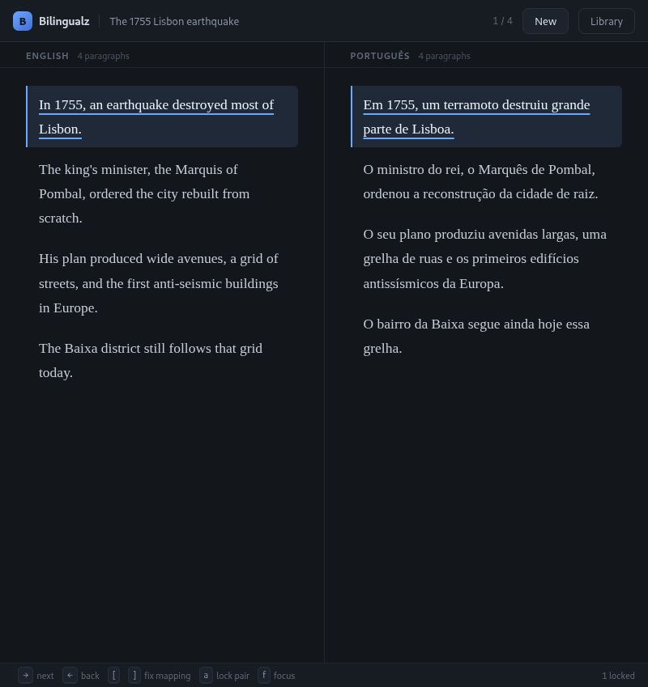

# Bilingualz

Read a text in two languages at once. Click a line on one side and the matching
line underlines on the other. Press <kbd>&rarr;</kbd> to keep reading.

Built for English &harr; Portuguese, but nothing in the engine is
Portuguese-specific.



---

## What it does

- **Two texts, one view.** Paste the English and the Portuguese. The engine works
  out which paragraph is which and keeps both panes in step.
- **Underline, don't search.** Select a paragraph and its counterpart lights up.
  <kbd>&rarr;</kbd> advances both sides together, so you never lose your place.
- **When it guesses wrong, one keystroke fixes it.** <kbd>[</kbd> / <kbd>]</kbd>
  shift the Portuguese side by a paragraph and lock it as truth. Everything after
  it re-aligns around the correction.
- **Translate mode.** Only have one side? Machine-translate it and the mapping is
  exact (paragraph *i* came from paragraph *i*) - no guessing at all.
- **Resume later.** Progress is saved per document, on disk, in plain JSON.

## Running from source

```bash
python -m venv .venv
. .venv/bin/activate          # Windows: .venv\Scripts\activate
pip install -e .

python run.py                 # or: ./run.sh  /  run.bat
```

You need a WebView backend. On Windows that is the Edge WebView2 runtime, already
present on Windows 11 and almost all Windows 10 installs. On Linux install
`webkit2gtk` (or `pywebview[qt]`); on macOS the system WebKit is used.

## Keys

| Key | Action |
| --- | --- |
| <kbd>&rarr;</kbd> <kbd>&darr;</kbd> <kbd>Space</kbd> <kbd>j</kbd> | next pair |
| <kbd>&larr;</kbd> <kbd>&uarr;</kbd> <kbd>k</kbd> | previous pair |
| <kbd>[</kbd> <kbd>]</kbd> | shift the Portuguese side, lock it as an anchor |
| <kbd>a</kbd> | lock the current pair as correct |
| <kbd>f</kbd> | focus mode (dim everything else) |
| <kbd>Home</kbd> / <kbd>End</kbd> | first / last |
| <kbd>Esc</kbd> | close a dialog |

## How the alignment works (no LLM, no network)

The engine never translates and never maps words. It asks one question: *of all
the Portuguese paragraphs here, which one is most likely the same paragraph as
this English one?* It answers with cheap, language-agnostic evidence:

| Signal | Example |
| --- | --- |
| Numbers survive translation | `1755` &harr; `1755` |
| Proper nouns share a stem | `Lisbon` &harr; `Lisboa` (`lisb`) |
| Cognates share a stem | `destroyed` &harr; `destruiu` (`dest`) |
| Length ratio is predictable | Portuguese runs ~10% longer |
| Order is preserved | a paragraph never jumps to another chapter |

The last one is the important one. Candidates are restricted to **monotone
paths** through the two documents, so an ambiguous paragraph is disambiguated by
its neighbours. That is also how merges and splits appear naturally:
`Pair([4, 5], [4])` means two English paragraphs became one Portuguese one.

Steps allowed per pair: 1-1, 1-2, 2-1, 1-3, 3-1. The search runs in a diagonal
band, so a 1,500-paragraph book aligns in a couple of seconds, once, at import.

Every pair carries a confidence score. Below `0.55` the underline is dashed so
you know where to look; <kbd>]</kbd> fixes it.

### Tuning

`bilingualz/config.py` holds the only knobs that matter: `LENGTH_MU`,
`LENGTH_SIGMA`, `DP_BAND`, `MAX_GROUP`, `LOW_CONFIDENCE`. Try a fixture from the
command line before touching the UI:

```bash
python -m bilingualz.cli align samples/en.txt samples/pt.txt --show 20
python -m bilingualz.cli align samples/en.txt samples/pt.txt --anchor 3,4 --json pairs.json
```

## Translate mode

One text in, the other generated. Because we translate paragraph by paragraph,
the correspondence is known rather than inferred, so there is no alignment error
at all - only translation quality.

Engines, in order of preference:

| Engine | Setup | Notes |
| --- | --- | --- |
| **Argos** (default) | `pip install -e ".[translate]"` | Offline, unlimited, no key. Model per direction, ~100-300 MB, fetched on first use. Fair quality. |
| **Azure Translator F0** | `pip install -e ".[azure]"` + env vars | 2M characters/month free. Much better quality. |
| none | - | Translate mode emits `[pt] ...` placeholders so the UI still works. |

```bash
# offline
export BILINGUALZ_TRANSLATOR=argos

# Azure free tier
export BILINGUALZ_TRANSLATOR=azure
export BILINGUALZ_AZURE_KEY=...
export BILINGUALZ_AZURE_REGION=brazilsouth   # or global, westeurope, ...
```

Translations are cached on disk by content hash, so re-opening a document or
re-aligning costs zero API calls.

> Machine translation is not the published edition. If you own both books, paste
> both texts and use parallel mode - that is the mode that reads real prose.

## Where your data lives

```
Windows : %APPDATA%\Bilingualz\
Linux   : ~/.local/share/Bilingualz/
macOS   : ~/Library/Application Support/Bilingualz/
```

`docs/<id>.json` is the whole document - text, pairs, anchors, progress. Plain
JSON, safe to copy or back up. Override the location with `BILINGUALZ_HOME`.

## Building the Windows .exe

**PyInstaller cannot cross-compile.** A `.exe` must be produced on Windows,
either on a Windows machine or in CI. From Linux the easiest route is the
included GitHub Actions workflow.

On Windows:

```bat
packaging\build-windows.bat
```

That creates `dist\Bilingualz\Bilingualz.exe` (a folder build - fast startup).
Add an installer with Inno Setup:

```bat
iscc packaging\bilingualz.iss
```

From Linux / CI: push a `v*` tag or run the **build-windows** workflow manually.
The artifact contains both the folder build and the setup executable.

Two practical notes:

- Build with **Python 3.12**. `pythonnet` and `ctranslate2` wheels are most
  reliable there; 3.13/3.14 support lags.
- If you want Argos *inside* the exe, run
  `pip install -e ".[translate]"` before `pyinstaller`. The spec detects it and
  bundles it. Otherwise the exe stays around 40-60 MB and translate mode is
  Azure-only.

## Project layout

```
bilingualz/
├── bilingualz/
│   ├── api.py            # the bridge the UI calls (no HTTP server)
│   ├── main.py           # pywebview window
│   ├── ingest.py         # pasted text -> clean paragraphs
│   ├── store.py          # JSON persistence
│   ├── models.py         # Document, Pair
│   ├── cli.py            # headless aligner harness
│   ├── align/
│   │   ├── signals.py    # numbers, names, cognate stems
│   │   ├── length_dp.py  # banded monotone DP  (parallel mode)
│   │   ├── identity.py   # index pairing      (translate mode)
│   │   ├── anchors.py    # user corrections
│   │   └── base.py       # Aligner protocol  <- swap point for v2
│   ├── translate/        # Argos / Azure / cache
│   └── web/              # the UI (vanilla HTML/CSS/JS, no build step)
├── tests/                # 40 tests, no GUI required
├── packaging/            # PyInstaller spec, Inno Setup, build script
└── samples/              # tiny EN/PT fixture
```

The UI is plain HTML served from `file://` inside the native window, so there is
no localhost, no port, and no firewall prompt. Open `bilingualz/web/index.html`
in any browser and it runs against an in-memory mock - handy for UI work.

## Known limits

- **Poetry or freely reordered translation** breaks monotonicity; anchors carry
  you, but expect to use them.
- **Garbage OCR** produces fake paragraph boundaries. Clean the text first.
- **Very different editions** (abridged, heavily rewritten) may need several
  anchors before the mapping settles.
- Parallel mode is English-centric in its defaults (`LENGTH_MU` assumes
  Portuguese is the longer side). Flip the sides or retune for other pairs.

## Roadmap

- Text-to-speech read-along (`pyttsx3`/SAPI on Windows needs no download).
- Embedding-based aligner behind the same `Aligner` interface.
- Sentence-level stepping inside a long paragraph.
- EPUB import with per-chapter anchors.

## License

MIT. See [LICENSE](LICENSE).
